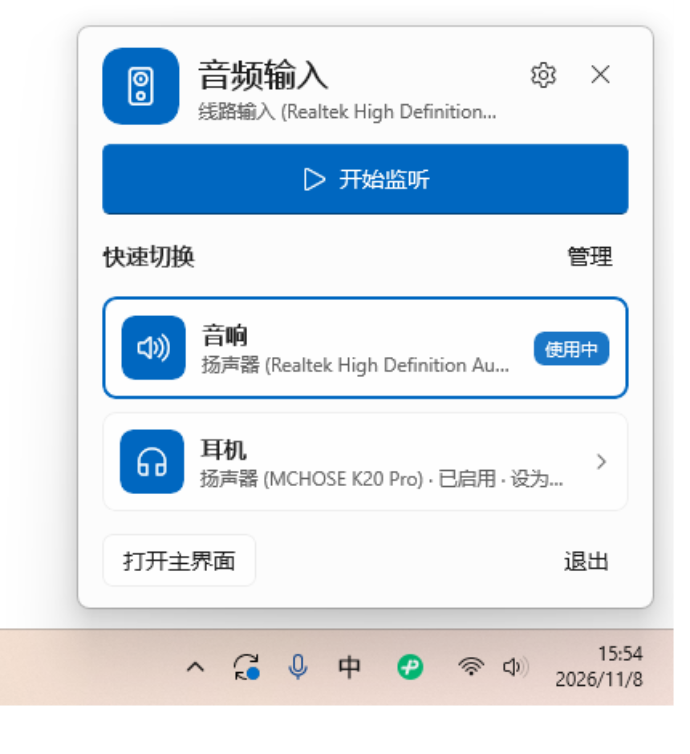

# LineInTray WinUI 3

按 EncoDeck 的 WinUI 3 结构重做的线路输入监听 / **音频输出快捷切换**工具。当前版本 3.0.1。

监听始终固定在线路输入；快捷卡片切换的是 **Windows 默认播放设备**（音响、耳机、显示器等），不会改变录音输入。

| 托盘面板 | Win+A 面板 |
| --- | --- |
|  |  |

主界面：


## 系统要求

- Windows 11 24H2（build 26100）或更高，Win+A 面板依赖 `ControlCenterWindow`。
- .NET 10 Desktop Runtime。
- Windows App Runtime 2.5（安装 EncoDeck 后通常已经存在）。
- 如果游戏加加仍在运行，请在游戏加加设置里把 `LineInTrayWinUI.exe` 加入覆盖层排除；这个版本不再用签名策略强行拦截注入。

## 安装

1. 解压整个文件夹，不要只拿 exe。
2. 双击 `install-winui.cmd`。
3. 脚本会复制到 `%LOCALAPPDATA%\Programs\LineInTrayWinUI`，把 exe 设为 Medium 完整性，并创建桌面快捷方式“音频输出快捷切换”。
4. 从桌面快捷方式启动。托盘图标默认在任务栏 `^` 隐藏区。

## 功能

- 监听输入始终是**线路输入**，不会因为切换快捷卡片而改录音设备。
- 快捷卡片绑定的是**播放设备**；点击后设置 Windows 默认播放设备（Console/Multimedia/Communications 三个角色），监听正在运行时自动把监听输出切到该设备。
- 主界面“+ 添加快捷方式”里选择“音频输出”，填写名称（音响、耳机、显示器等）和图标。
- 如果多个快捷卡片指向同一个输出，面板会提示；新增快捷方式会优先选择尚未使用的输出设备。
- 设备切换、监听启停和 WASAPI 初始化都在后台串行执行，UI 线程不阻塞。

## UI 结构

- `QuickPanelWindow`：托盘 Acrylic 面板，360 DIP，圆角、Fluent 卡片。
- `QuickSettingsPanelWindow`：Win+A 时贴在 Quick Settings 卡片**正上方**、与卡片同宽；`WS_EX_NOACTIVATE`、`WS_EX_TOOLWINDOW`、Acrylic，和系统面板同时出现/关闭。
- `QuickSettingsWatcher`：`SetWinEventHook` 监听 `ControlCenterWindow` 的显示/隐藏/前台变化，50 ms 跟随卡片区域。
- 主界面：Mica/Fluent 卡片，主题为跟随系统 / 浅色 / 深色，快捷面板主题可单独设置。
- 托盘：`H.NotifyIcon.WinUI`；左键打开快捷面板，右键菜单打开主界面/启停监听/退出。
- 快捷键：`Ctrl+Alt+Shift+L` 打开/关闭托盘快捷面板。

## 构建

```powershell
powershell -ExecutionPolicy Bypass -File .\build-winui.ps1
```

需要 .NET 10 SDK；脚本会优先使用仓库内 `.tools\dotnet`，否则使用 PATH 上的 `dotnet`，发布到 `dist-winui`。

