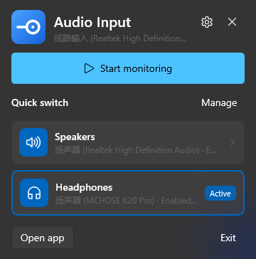
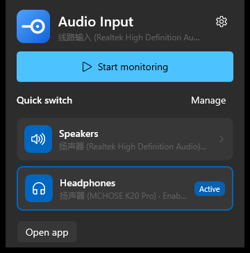
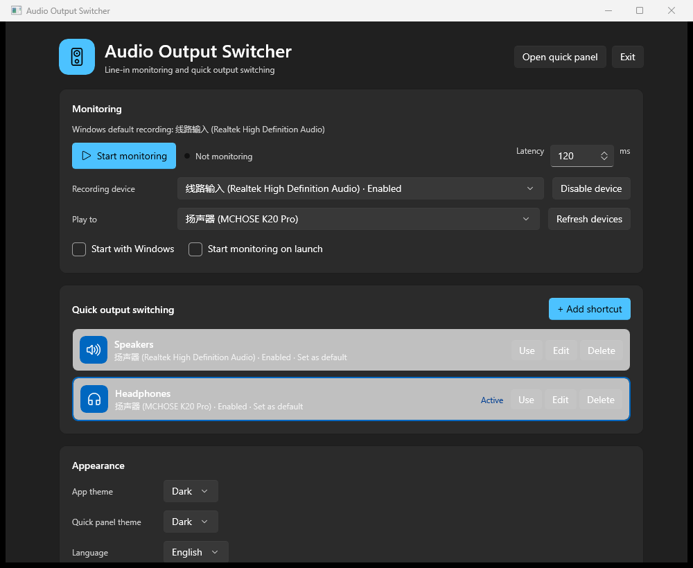

<p align="center"></p>

# Audio Output Switcher

**English** | [简体中文](README_zh.md)

A Windows 11 tray utility that keeps **line-in monitoring** running while letting you switch the **default audio output** (speakers, headphones, monitor, ...) from a compact Fluent panel.

Unlike a simple “sound output” menu, the shortcuts are always visible: click the tray icon, use `Ctrl+Alt+Shift+L`, or press `Win+A` to open the companion panel directly above Windows Quick Settings.

| Tray panel | Win+A companion panel |
| --- | --- |
|  |  |



## Features

- **Output switching first** — the quick-switch cards are the primary feature and remain available even when monitoring is off.
- **Optional monitoring** — enable “Line-in monitoring” in the main window only when you need it. When it is off, the Win+A companion panel still opens for output switching; only its monitoring section is hidden, and no audio is captured.
- **Fixed line-in source** — when monitoring is enabled, it always uses the line-in capture device.
- **Quick output switching** — shortcut cards set the Windows default playback device for all three roles (Console, Multimedia, Communications).
- **Win+A companion panel** — uses WinEvent hooks on `ControlCenterWindow`, is placed above the Quick Settings cards with the same width, and never takes focus away from the system flyout.
- **Native Fluent UI** — WinUI 3, Windows App SDK, Acrylic backdrop, Mica main window, Composition animations.
- **Tray integration** — `H.NotifyIcon.WinUI`; left click opens the panel, right click opens the menu.
- **Light / dark / system theme** — app theme and quick-panel theme can be chosen separately.
- **English / 简体中文** — follows the Windows display language by default and can be changed in Settings.
- **Background audio pipeline** — device enumeration is cached; switching, WASAPI start/stop and default-device changes run off the UI thread.
- **Optional Start with Windows** — toggle it in the Other card; the app registers itself under the current-user Run key.
- **Zero-latency default** — the monitor latency default is 0 ms and can be adjusted from 0 to 500 ms.

## Requirements

- Windows 11 24H2 (build 26100) or newer for the Win+A companion panel.
- Windows App Runtime 2.5 (usually installed with EncoDeck or another WinUI 3 app).
- The release is self-contained for .NET; no separate .NET Desktop Runtime is required.
- If GamePP (游戏加加) is running, add `AudioOutputSwitcher.exe` to its overlay exclusion list. The app no longer uses a signature policy to block third-party overlays.

## Install

1. Download the release zip and extract the **whole folder** — the app is not a single-file executable.
2. Run `install-winui.cmd`.
3. The script copies the app to `%LOCALAPPDATA%\Programs\AudioOutputSwitcher`, marks the exe as Medium integrity, and creates a desktop shortcut named **Audio Output Switcher**.
4. Launch it from the shortcut. The tray icon is usually in the taskbar overflow (`^`).

## Usage

- **Start monitoring** — monitors line-in through the currently selected/default playback device.
- **Shortcut cards** — click “Speakers” or “Headphones” to change the Windows default output. If monitoring is running, the monitor output follows the new device.
- **Add shortcut** — main window → “+ Add shortcut” → choose an audio output, name and icon.
- **Language** — Settings → Language → `Use system language`, `English` or `简体中文`.
- **Theme** — Settings → App theme / Quick panel theme.

## Build

Requires the .NET 10 SDK and Windows App SDK 2.5.1 packages.

```powershell
powershell -ExecutionPolicy Bypass -File .\build-winui.ps1
```

The script uses `.tools\dotnet` when present, otherwise `dotnet` from `PATH`, and publishes to `dist-winui`.

## Notes

- Windows has no public API for embedding custom controls inside the volume flyout. This project places its own panel above the Win+A Quick Settings cards and shows/hides it together with the system panel.
- UI structure is inspired by [EncoDeck](https://github.com/TIANLI0/EncoDeck), but the implementation is original WinUI 3 code.
- Third-party notices are in [THIRD-PARTY-NOTICES.txt](THIRD-PARTY-NOTICES.txt).

## Repository

https://github.com/Biexone/AudioOutputSwitcher


