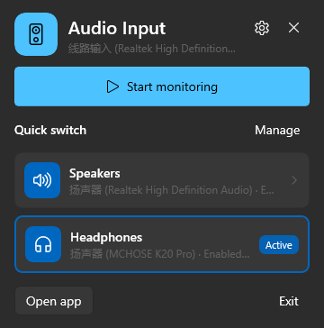
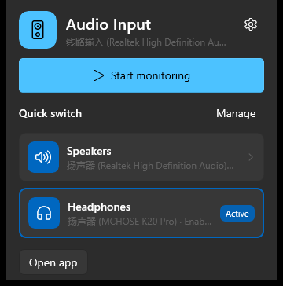
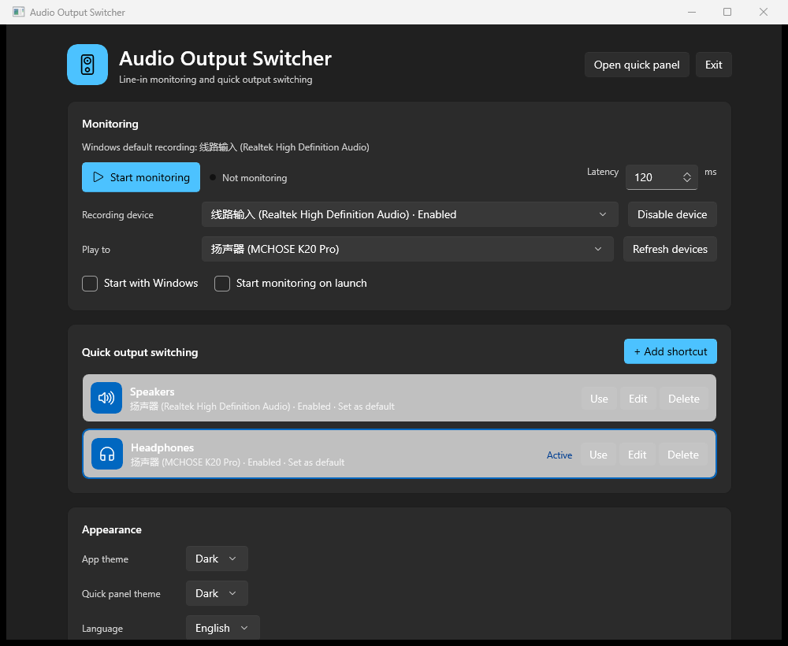

# LineInTray

[English](README.md) | **简体中文**

一个常驻 Windows 11 托盘的线路输入监听 + **音频输出快捷切换**工具：监听始终使用线路输入，快捷卡片只切换 Windows 默认播放设备（音响、耳机、显示器等）。

| 托盘面板 | Win+A 面板 |
| --- | --- |
|  |  |



## 功能

- **监听固定线路输入**：快捷卡片不会改变录音设备。
- **快速切换输出**：设置 Windows 默认播放设备的 Console / Multimedia / Communications 三个角色。
- **Win+A 附加面板**：用 WinEvent 监听 `ControlCenterWindow`，贴在 Quick Settings 卡片正上方、与卡片同宽，不抢系统弹窗焦点。
- **原生 Fluent UI**：WinUI 3、Windows App SDK、Acrylic 浮层、Mica 主窗口、Composition 动画。
- **托盘**：`H.NotifyIcon.WinUI`，左键面板、右键菜单。
- **主题**：跟随系统 / 浅色 / 深色，主界面和快捷面板可分别设置。
- **中英文**：默认跟随 Windows 显示语言，也可在设置中切换 English / 简体中文。
- **后台音频**：设备列表缓存；切换输出、启停监听、WASAPI 初始化都在 UI 线程外执行。

## 系统要求

- Windows 11 24H2（build 26100）或更高，Win+A 面板需要。
- Windows App Runtime 2.5（安装 EncoDeck 等 WinUI 3 应用后通常已有）。
- 发布包已自包含 .NET 运行时。
- 如果游戏加加正在运行，请在它的覆盖层设置里排除 `LineInTrayWinUI.exe`。

## 安装

1. 解压完整文件夹，不要只拿 exe。
2. 运行 `install-winui.cmd`。
3. 脚本会复制到 `%LOCALAPPDATA%\Programs\LineInTrayWinUI`，把 exe 设为 Medium 完整性，并创建桌面快捷方式“音频输出快捷切换”。
4. 从桌面快捷方式启动；托盘图标通常在任务栏 `^` 隐藏区。

## 使用

- **开始监听**：监听线路输入，播放到当前默认/选中的输出设备。
- **快捷卡片**：点“音响/耳机”切换 Windows 默认播放设备；监听运行时会自动跟随。
- **添加快捷方式**：主界面 →“+ 添加快捷方式”→ 选择音频输出、名称、图标。
- **语言**：设置 →“界面语言”→ 跟随系统 / English / 简体中文。
- **主题**：设置 → 应用主题 / 快捷面板主题。

## 构建

需要 .NET 10 SDK 和 Windows App SDK 2.5.1 包。

```powershell
powershell -ExecutionPolicy Bypass -File .\build-winui.ps1
```

## 说明

- Windows 没有公开 API 可以把自定义控件嵌入音量弹窗；本程序在 Win+A 快速设置卡片上方显示独立面板，并随系统面板显示/关闭。
- UI 结构参考 [EncoDeck](https://github.com/TIANLI0/EncoDeck)，实现为本项目原创 WinUI 3 代码。
- 第三方声明见 [THIRD-PARTY-NOTICES.txt](THIRD-PARTY-NOTICES.txt)。
